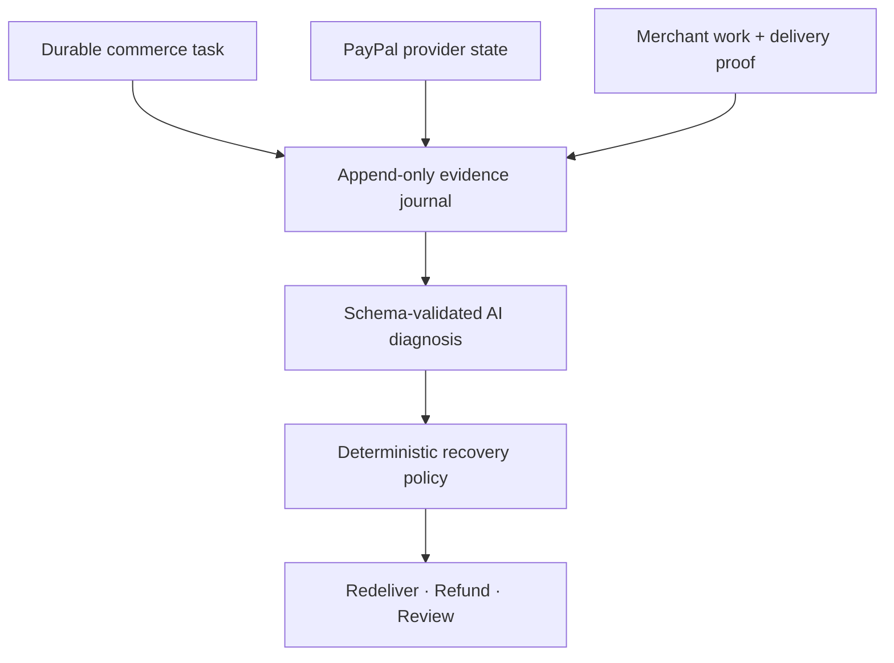

# REWIND

<p align="center">
  <strong>Evidence-first recovery for ambiguous PayPal transactions.</strong><br>
  Reconcile payment, merchant execution, and delivery before taking financial action.
</p>

<p align="center">
  <a href="https://github.com/Naren-M-5/rewind/actions/workflows/tests.yml"></a>
  
  
  
  <a href="LICENSE"></a>
</p>

> **Evidence before action.** A timeout is not proof that a payment failed. REWIND reconstructs the outcome and blocks unsafe retries before they create a duplicate charge.

**[Quick start](#quick-start) · [Architecture](#architecture) · [Recovery scenarios](#recovery-scenarios) · [PayPal Sandbox](#connect-paypal-sandbox) · [AI investigation](#ai-investigation) · [Verification](#evidence-and-verification)**

## Why REWIND

API idempotency protects an individual request. A commerce recovery decision spans more than one request: payment state, merchant work, and buyer delivery can disagree. REWIND gives that complete business task a durable identity, records an evidence timeline, and applies a conservative recovery policy.

- **Reconcile first:** authoritative PayPal state is read before any capture or refund decision.
- **Investigate with AI:** structured model output classifies conflicts and cites existing evidence IDs.
- **Keep money deterministic:** AI can stop an unsafe action, but verified state and policy authorize recovery.
- **Recover exactly once:** stable operation IDs and task-level guards prevent duplicate captures and refunds.

## Architecture



The AI layer interprets evidence. It has no payment credentials or financial tools. PayPal reads and deterministic policy remain authoritative.

## Verified build

This repository contains a runnable, evidence-backed prototype.

| Capability | Status |
| --- | --- |
| Three end-to-end recovery scenarios | Verified locally and with real PayPal Sandbox payment objects |
| Investigation dashboard, timeline, evidence export, recovered artifact download | Implemented |
| Durable operations, stable request IDs, restart recovery | Tested |
| PayPal sandbox Orders, buyer approval, capture, authoritative reads, refunds | Three credentials-backed scenarios passed; redacted reports included |
| PayPal webhook signature verification and event deduplication | Implemented; real sandbox webhook delivery not yet verified |
| Hosted AI (OpenAI Responses / compatible Chat Completions) and Ollama | Implemented; unchanged six-case suite passed 6/6 with live local Ollama inference |
| Socket fault proxy, buyer receipt verification, redacted judge replay | Implemented and tested locally |
| AI recommendation overridden by deterministic policy | Tested with a visibly labeled recorded fixture |
| GitHub Actions | Passing on Python 3.11 and 3.12 |

Payment mode defaults to the emulator. **AI defaults to a live provider**, requiring your model name and API key; missing configuration is reported as unavailable, never silently replaced by a fixture. The explicit `--rehearsal` command below selects emulator payments and recorded AI. It still runs a separate merchant and buyer inbox over real HTTP.

**v0.2 verification: 57 tests pass.** The unchanged six-case evaluator passed **6/6** with Ollama 0.40.10 and `qwen3:8b`. All three core scenarios passed with real PayPal Sandbox orders, captures, and—in the terminal-failure scenario—a provider-confirmed refund. Redacted verification reports are committed under `docs/sandbox-evidence/`. GitHub Actions passes on Python 3.11 and 3.12. Real webhook delivery and hosted deployment are not claimed as complete.

## Quick start

### Windows PowerShell

Requires Python 3.11 or newer. Extract this folder, then open PowerShell inside it.

```powershell
py -m venv .venv
.\.venv\Scripts\python.exe -m pip install -e ".[dev]"
Copy-Item .env.example .env
.\.venv\Scripts\python.exe -m rewind.devstack --rehearsal
```

Open **http://127.0.0.1:8000**. Select a scenario and click **Open investigation**. No Node installation or frontend build is required.

Run tests in another terminal:

```powershell
.\.venv\Scripts\python.exe -m pytest -q
```

### Linux and macOS

```bash
python3 -m venv .venv
.venv/bin/python -m pip install -e '.[dev]'
cp .env.example .env
.venv/bin/python -m rewind.devstack --rehearsal
```

The launcher starts the dashboard (8000), merchant (8011), buyer inbox (8012), and fault proxy (8013). Ctrl+C stops them together. Keep these ports available. Service logs are in `logs/`. The stack, test suite, live Ollama evaluation, and three core Sandbox scenarios were run on Windows; see `docs/VERIFICATION.md`.

Use **one uvicorn worker per service**. This prototype's in-process task locks do not coordinate multiple workers or replicas.

## Recovery scenarios

| Scenario | Failure | Correct response |
| --- | --- | --- |
| Capture response lost | Sandbox proxy reads successful capture response, then closes the downstream socket; agent retries | Query provider, recover capture, block another task payment |
| Result delivery lost | Merchant persists a report; proxy drops delivery before reaching the buyer | Redeliver the original artifact without refunding or charging again |
| True execution failure | Payment succeeds; merchant worker terminates without producing an artifact | Refund the verified capture once; distinguish submitted/pending/completed refund |

The merchant and buyer are separate demo services with separate SQLite databases. Redelivery sends the original artifact bytes over HTTP; a matching buyer receipt and SHA-256 are required before reporting success. A socket proxy supports loss before delivery and loss after a successful upstream response. Faults are controlled simulations, not claims of a PayPal outage. In sandbox mode capture-response loss uses a real HTTP proxy; emulator capture-response loss remains an explicitly simulated provider operation.

The report is a small local demonstration artifact, not a purchased commercial research report. SHA-256 binds redelivery to the same bytes; it does not prove business quality or legal fulfillment.

## Connect PayPal sandbox

1. Create a sandbox REST app at https://developer.paypal.com/dashboard/applications/sandbox. Use its business seller credentials and a separate personal sandbox buyer.
2. Edit your **local** `.env`:

```dotenv
REWIND_PROVIDER=sandbox
REWIND_DB=rewind-sandbox.db
PAYPAL_CLIENT_ID=your_sandbox_client_id
PAYPAL_CLIENT_SECRET=your_sandbox_client_secret
REWIND_API_TOKEN=your_long_random_dashboard_token
REWIND_PUBLIC_URL=http://127.0.0.1:8000
```

3. Stop rehearsal and run `python -m rewind.devstack` with your virtual-environment Python. Configure live AI as below. Restart the server. Click **Connection settings** and enter the dashboard token. It is kept in tab session storage and is never embedded in the source archive.
4. Click **Create sandbox task**, then **Create order**. Click **Approve in sandbox** and approve with the personal sandbox buyer. Approval remains a buyer action; REWIND does not bypass it.
5. Return to the dashboard. For scenario 1, click **Drop capture response**, then **Capture** again. For scenarios 2/3, click **Capture**, then **Run merchant**, **Diagnose**, **Recover**.
6. Confirm the order/capture/refund IDs in the sandbox dashboard and compare their amount and status with REWIND. Emulator IDs always start with `SIM-`; real sandbox IDs do not.

Use a separate database per provider. The engine rejects tasks created under another provider.

### Webhooks

For real webhook testing, the app needs a reachable HTTPS URL. Register `/api/webhooks/paypal` on the sandbox REST app and put that webhook's ID in `PAYPAL_WEBHOOK_ID`. Subscribe to capture completed, pending, denied, and refunded events as applicable. Set `REWIND_PUBLIC_URL` to the HTTPS app origin for buyer redirects.

The handler verifies signatures through PayPal's verification API, stores an event ID once, and then retrieves authoritative order/capture state. Payload status alone never authorizes a refund. Replayed, delayed, and reordered events trigger reads rather than directly rewinding local financial state. Unmatched verified events are stored for investigation; this version has no background inbox-drain worker.

Do not use the webhook simulator as proof of a real capture integration. Verify with an actual sandbox transaction. Keep a dashboard token on any network-accessible deployment, and keep the demo limited to sandbox accounts.

### Sandbox-only endpoints used

- `POST /v1/oauth2/token`
- `POST /v2/checkout/orders`
- `GET /v2/checkout/orders/{id}`
- `POST /v2/checkout/orders/{id}/capture`
- `GET /v2/payments/captures/{id}`
- `POST /v2/payments/captures/{id}/refund`
- `POST /v1/notifications/verify-webhook-signature`

There is deliberately no live-payment base URL.

## AI investigation

### Configure a live model

Store credentials only in your local `.env`. Never send account passwords, API secrets, or buyer credentials in chat or commit them. A hosted provider needs an API key with inference access; use your chosen provider's own account and model identifier.

```dotenv
REWIND_AI=openai_compatible
REWIND_AI_BASE_URL=https://api.openai.com/v1
REWIND_AI_MODEL=your_available_model_id
REWIND_AI_API_KEY=your_private_api_key
```

For the OpenAI Responses API, use `REWIND_AI=openai` with the same base URL. Compatible providers must support strict JSON-schema output. Provider compatibility and model quality must be measured, not assumed. No paid account or billing setup is created by this project.

For local inference, select `REWIND_AI=ollama`, `OLLAMA_URL=http://127.0.0.1:11434`, and `OLLAMA_MODEL=your_installed_model`. Start Ollama separately and install that model. The example's 3B model is unbenchmarked; its presence is not evidence of useful contradiction detection. Fixture mode is explicit (`--rehearsal` or `REWIND_AI=fixture`), and is not live inference.

The model receives evidence without credentials or financial tools. Its structured diagnosis is schema-validated and must cite existing event IDs. It classifies a **delivery gap** separately from a **fulfillment conflict**: “buyer got nothing” and “merchant completed the report” can both be true. Conflicting terminal merchant events or artifact digests flag a real conflict in the normal flow. New untrusted messages hold refund recovery until a fresh live diagnosis is obtained. AI can add a stop, never authorize an otherwise forbidden payment action.

Run the six-case evaluation with your configured model:

```bash
python -m rewind.evaluate_ai --output local-runs/ai-eval.json
```

This checks recovered payment, delivery gap, true failure, conflicting merchant state, prompt injection, and pending payment. It records diagnosis, expected classification, latency, and pass count. The unchanged suite passed **6/6** with Ollama 0.40.10 and `qwen3:8b`; the report is preserved at `docs/ai-evidence/ai-eval-qwen3-6-of-6.json`. Fixture mode deliberately proposes a refund for a completed artifact so the policy override can be rehearsed; the UI labels recorded fixture findings explicitly.

## Verify real sandbox runs

Keep `python -m rewind.devstack` running with sandbox and live AI configured. In a second terminal with the same environment:

```bash
python -m rewind.verify_sandbox start --scenario true_failure --report local-runs/refund.json
# Open the printed approval URL and approve with your personal sandbox buyer.
python -m rewind.verify_sandbox resume --report local-runs/refund.json
```

Repeat with `capture_timeout` and `delivery_loss`, each with a new report filename. The runner persists progress, checks task/order binding, records capture count, requires live inference, and verifies the refund or buyer receipt. The timeout scenario additionally requires the proxy's record of a successful upstream capture followed by a socket drop. A failed check stays incomplete. These commands operate only on sandbox money; buyer approval is still required. Full checks, including webhooks and restart recovery, are in [SANDBOX_SPIKE.md](docs/SANDBOX_SPIKE.md).

## Judge access without credentials

After real runs succeed, export selected task IDs from your sandbox database:

```bash
python -m rewind.replay --db rewind-sandbox.db --task TASK_ID_1 --task TASK_ID_2 --task TASK_ID_3 --output docs/judge-replay.json
$env:REWIND_REPLAY_FILE = "docs/judge-replay.json"
python -m uvicorn rewind.replay:create_replay --factory --host 127.0.0.1 --port 8000
```

Stop the regular stack before using its port. A redacted replay of the three verified runs is included at `docs/judge-replay.json`. It removes free-text messages, artifact contents, and approval URLs. It retains recorded sandbox IDs and labels the display **read-only recorded evidence**, not current provider verification. Its app instantiates no payment or AI adapter and exposes no mutation endpoints.

A hosted replay can be public without buyer credentials or a dashboard token. Hosting has not been completed. The replay can be used with the source and local instructions; it is recorded evidence, not a live sandbox integration. The bundled file was exported from the local Sandbox database and passed the release redaction checks.

## Safety boundaries and limits

- SQLite persists task snapshots, events, provider-emulator objects, and operation keys. This is a durable journal with snapshots, **not** a complete event-sourced or tamper-proof ledger.
- A durable operation is recorded before each provider mutation. Its request ID is stable across retries and process restarts.
- Unresolved operations older than one hour are not automatically retried. That conservative local bound avoids implying an infinite provider idempotency window; actual retention is endpoint-specific.
- Recovery re-reads provider state immediately before evaluating policy. Capture amount, currency, and task binding must match.
- Multiple captures, partial refunds, unresolved status, or contradictory trusted state require investigation.
- A pending refund is not displayed as completed. A lost refund response triggers reconciliation rather than a new request ID.
- Merchant terminal state is trusted **only within the controlled local demo merchant**. External merchant authentication, attested fulfillment, cancellation fencing, and race-safe refund/fulfillment coordination are not implemented.
- In-process locks require a single worker. Horizontal scaling needs distributed locking, transactional leases, and an outbox before production use.
- AI output and user-pasted evidence do not establish financial truth. Invalid inference is labeled unavailable; no fake inference is silently substituted.
- The API uses a shared dashboard token, not production multi-user authentication. `.env` and database files are excluded from source control.
- `REWIND_CHAOS=false` disables task creation and demo-merchant/fault controls. It does not turn the prototype into a production service.

## Evidence and verification

See [VERIFICATION.md](docs/VERIFICATION.md), [SANDBOX_SPIKE.md](docs/SANDBOX_SPIKE.md), the redacted [judge replay](docs/judge-replay.json), and the scenario reports under [`docs/sandbox-evidence/`](docs/sandbox-evidence/).

The read-only judge replay and redacted scenario reports are committed, and CI passes from a clean checkout. Real webhook delivery remains an explicitly documented limitation. Dispute export in this build is a local JSON package; no evidence is submitted to PayPal.

## Primary references

- [PayPal idempotency](https://developer.paypal.com/api/rest/reference/idempotency/)
- [Orders v2](https://developer.paypal.com/api/orders/v2)
- [Payments v2](https://developer.paypal.com/api/payments/v2)
- [Webhook verification](https://developer.paypal.com/api/webhooks/v1)
- [Disputes integration and sandbox scope requirement](https://developer.paypal.com/platforms/disputes/integrate-disputes/)
- [OpenAI structured outputs](https://developers.openai.com/api/docs/guides/structured-outputs)
- [Ollama structured outputs](https://docs.ollama.com/capabilities/structured-outputs)

No competition or novelty claims are established by the implementation. REWIND's differentiator is the task spanning payment, fulfillment, and delivery, not basic HTTP retry protection.

## License

MIT. See [LICENSE](LICENSE).

